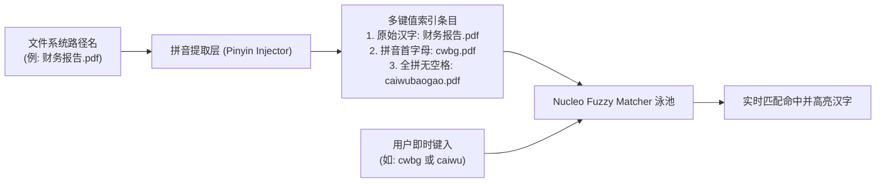

# Atlas 文件管理器 — CJK（中日韩/简体中文）系统架构与体验审计报告

**文档版本**: 1.0.0  
**制定日期**: 2026-10-23  
**目标平台**: Windows 10 (1809+) / Windows 11 (21H2+)  
**适用模块**: `atlas-ui` (GPUI 渲染层), `atlas-core` (文件系统检索与排序), `atlas-search-service` (索引服务)

---

## 1. 概述与背景

随着 Atlas 文件管理器推向大中华区市场及 Microsoft Store 简体中文区，界面的本地化不仅仅是多语言字符串文本（i18n）的直译，更涉及底层排版渲染引擎、文本塑形（Text Shaping）、字符宽度度量、系统字体回退（Font Fallback）机制，以及中文特有的拼音排序（Pinyin Collation）与拼音模糊搜索（Pinyin Fuzzy Search）等深层体验。

本审计报告针对 Atlas 现有的架构（Rust + GPUI + DirectWrite + Nucleo 模糊匹配）进行深度技术剖析，提出针对性的工程实施方案与最佳实践标准。

---

## 2. Windows DirectWrite 与 GPUI 字体回退架构（Font Fallback）

### 2.1 现状分析

在当前实现中（参见 `crates/atlas-ui/src/lib.rs` 与 `crates/atlas-ui/src/assets.rs`）：
```rust
// crates/atlas-ui/src/assets.rs
pub fn bundled_fonts() -> Vec<Cow<'static, [u8]>> {
    vec![
        Cow::Borrowed(include_bytes!("../assets/fonts/geist/Geist-Variable.ttf")),
        Cow::Borrowed(include_bytes!("../assets/fonts/geist/GeistMono-Variable.ttf")),
    ]
}

// crates/atlas-ui/src/lib.rs
if let Err(err) = cx.text_system().add_fonts(crate::assets::bundled_fonts()) {
    tracing::warn!(?err, "failed to load bundled Geist fonts");
}
```

Atlas 内置打包了 Vercel 的开源西文字体 **Geist Variable**。Geist 是一套高质量的现代无衬线西文字体，但其字库中**不包含** CJK（中日韩统一表意文字）字形。

### 2.2 DirectWrite 回退链路机制

在 Windows 平台上，GPUI 的底层文本子系统依赖 DirectWrite（`IDWriteFontFallback` / `IDWriteTextAnalyzer`）。当 GPUI 遇到 Geist 字库中缺失的汉字字符（如 `U+4E00`–`U+9FFF`）时，会触发 DirectWrite 系统的字符级字体回退查找：

1. **DirectWrite 默认回退链**：
   - 处于简体中文区域设置（`zh-Hans-CN`）的 Windows 系统中，DirectWrite 查询系统字体集合，首选回退至 **微软雅黑（Microsoft YaHei / Microsoft YaHei UI）**。
   - 罕见字或扩展区汉字（CJK Extension B~G）会进一步回退至 **SimSun-ExtB** 或 **Segoe UI Historic**。
   - 等宽文本环境（如终端、十六进制查看器）下若缺少等宽中文，则回退至 **新宋体（NSimSun）**。

### 2.3 潜在问题与技术隐患

1. **行高与基线抖动（Baseline & Metric Discrepancies）**：
   - Geist 的 `OS/2` 度量参数（TypoAscender/Descender）与微软雅黑的度量参数存在显著差异。在包含中英文混排的标签、路径栏（如 `C:\Users\张伟\Documents`）或文件列表中，如果渲染框架以当前行内最高字体度量动态撑开行高，会导致列表行高在纯英文行与包含中文行之间发生微小跳变（Jitter）。
   - **解决方案**：在 GPUI 主题层固定统一的 `line_height`（以绝对像素 `px(22.0)` 或基于 rem 的固定行高锁定），并在文本行容器中启用统一垂直对齐（居中对齐或基线对齐锁定），屏蔽因回退字形度量差异带来的跳动。

2. **字重映射与人工伪粗体（Weight Synthesis）**：
   - Geist 支持 100~900 的精细连续 Variable 字重调节。
   - 微软雅黑在 Windows 系统中标准安装主要包含 `Regular` (400)、`Bold` (700) 以及部分版本的 `Light` (300)。
   - 当 UI 元素请求 `Medium` (500) 或 `SemiBold` (600) 字重时（如清理分析器的标题、分类标签），DirectWrite 若未正确配置匹配策略，可能采用算法描边合成“伪粗体”（Faux Bold），导致笔画交叉处模糊发黑；或向下取整回退至 Regular，导致中西文字重视觉失衡。
   - **解决方案**：在 GPUI 字体族样式链中，显式声明支持中文字体的推荐回退列表：
     ```rust
     font_family = ["Geist", "Segoe UI Variable Text", "Microsoft YaHei UI", "PingFang SC", "sans-serif"]
     ```
     确保 Windows 11 下优先匹配具有无级可变字重的 `Segoe UI Variable`，中文字符平滑回退至抗锯齿清晰优化的 `Microsoft YaHei UI`。

---

## 3. 文本塑形、字符宽度（全角/半角）与列表列宽自适应

### 3.1 字符宽度标准（Unicode East Asian Width - UAX #11）

在文件列表、重命名输入框及详细信息视图中，字符宽度的度量直接决定布局美感：
* **半角字符（Half-Width / Narrow / `Na`）**：标准 ASCII 字母、数字及半角标点，在比例字体中宽度通常在 `0.4 em ~ 0.6 em` 之间，在等宽字体中占 `1 ch`。
* **全角字符（Full-Width / Wide / `F` / `W`）**：中文汉字、全角标点符号（如 `“ ” （ ） 【 】 ： ， 。`）、中文输入法下的全角空格，宽度为标准的 `1 em`（或等宽字体下的 `2 ch`）。

### 3.2 详细信息视图（Details View）自适应宽度计算

在 `crates/atlas-ui/src/ui/views/details.rs` 中：
```rust
// 列宽计算核心逻辑依赖真实像素尺寸
fn details_column_width_raw(...) -> f32
```
* **避免字节与字符数陷阱**：
  在早期的文件管理器中，开发者常误用 `str.len()`（字节长度，UTF-8 下汉字为 3 字节）或 `str.chars().count()`（字符数）估算列宽。对于 8 个英文字符（"filename" ~ 50px）与 8 个中文字符（"财务审计报告文件" ~ 110px），视觉宽度相差一倍以上。
* **GPUI 塑形度量建议**：
  对于列宽自动适应双击操作（Auto-fit on Header Double-Click），必须调用 GPUI 文本系统的单行塑形接口度量真实外接矩形：
  ```rust
  let shaped_line = window.text_system().shape_line(
      text,
      font_size,
      &[TextRun { font: font.clone(), color, underline: None }]
  );
  let content_width = shaped_line.width;
  ```
* **末尾文本截断（Truncation & Ellipsis）**：
  `shape_text_truncated` 在执行截断时，必须遵循 Unicode 字素簇（Grapheme Cluster）边界截断，并在末尾附加中文常用省略号 `…`（`U+2026`），避免将复合表意字符拆碎或导致悬挂半字符。

---

## 4. 中文文件名排序机制（拼音排序 vs Unicode 码点排序）

### 4.1 现存机制审计

当前 `atlas-core` 中的自然排序实现（`crates/atlas-core/src/fs/list.rs`）：
```rust
pub fn natural_cmp(a: &str, b: &str) -> std::cmp::Ordering {
    let mut a = a.case_fold().peekable();
    let mut b = b.case_fold().peekable();
    // 针对 ASCII 数字分块进行自然数值对比，其余字符按 char::cmp 比较
    ...
}
```

* **核心问题**：
  在 Rust 原生的 `char::cmp` 中，汉字是按照 **Unicode 标量值（Scalar Value）** 进行大小比较的（从 `U+4E00` 一直延伸）。Unicode 汉字编码主要是基于《康熙字典》的部首检字法或历史字符集编码次序排列的，**完全不符合汉语拼音首字母（A–Z）次序**！
* **用户体验断层**：
  在原版 Windows 文件资源管理器（简体中文版）中，文件是严格按照**汉语拼音首字母（A 到 Z）**排列的。例如：
  - “安徽.xlsx” (An -> A)
  - “北京.docx” (Beijing -> B)
  - “长春.txt” (Changchun -> C)
  - “武汉.pdf” (Wuhan -> W)
  
  若仅使用 Unicode 码点自然排序，以上顺序将被完全打乱，导致国内 Windows 用户产生强烈的“不自然感”和查找困难。

### 4.2 优化建议方案

针对 Windows 平台的生产环境优化，建议采用分层 Collation 策略：

1. **Windows 原生平台实现（首选）**：
   在 `windows` 平台上通过 Win32 API `CompareStringEx` 进行本地化比较：
   ```rust
   #[cfg(windows)]
   pub fn localized_compare(a: &str, b: &str) -> std::cmp::Ordering {
       use windows::Win32::Globalization::{CompareStringEx, CSTR_LESS_THAN, CSTR_EQUAL, CSTR_GREATER_THAN, COMPARE_STRING_FLAGS};
       use windows::core::HSTRING;
       
       let wa = HSTRING::from(a);
       let wb = HSTRING::from(b);
       
       // 使用 LOCALE_NAME_USER_DEFAULT，系统中文时自动采用拼音权重 (SORT_CHINESE_PRC)
       let res = unsafe {
           CompareStringEx(
               windows::core::w!("!x-sys-default-locale"),
               COMPARE_STRING_FLAGS(0x00000001), // NORM_IGNORECASE
               wa.as_wide(),
               wb.as_wide(),
               None,
               None,
               0,
           )
       };
       match res {
           CSTR_LESS_THAN => std::cmp::Ordering::Less,
           CSTR_GREATER_THAN => std::cmp::Ordering::Greater,
           _ => std::cmp::Ordering::Equal,
       }
   }
   ```
2. **跨平台兼容回退**：
   在非 Windows 或无 Windows API 环境下，集成 Rust 社区高评级的纯 Rust `pinyin` 拼音转换库，或者使用 `unicode-collation` / ICU4X。

---

## 5. 中文文件名即时模糊搜索（Pinyin Fuzzy Search）

### 5.1 现状与用户习惯

Atlas 当前依赖 `nucleo` 引擎提供极佳的模糊搜索能力（`crates/atlas-core/src/search/fuzzy.rs` 与 `search/nucleo_pool.rs`）。
* Nucleo 针对英文字母的子序列匹配、单词边界加权进行了深度优化。
* 但在中文工作环境下，用户的典型搜索习惯包括：
  1. **首字母缩写搜索（Initialism / Pinyin Acronyms）**：
     输入 `wjgl` 期望匹配 `文件管理.docx`（**W**en **J**ian **G**uan **Li**）。
  2. **无声调全拼搜索（Full Pinyin）**：
     输入 `wenjian` 期望匹配 `文件.txt`。
  3. **汉字与英文混合匹配**：
     输入 `atlas wenjian` 期望匹配 `Atlas文件管理器.exe`。

### 5.2 架构实施路线图（Roadmap）

为了让 Atlas 在中文搜索体验上达到 Everything / Listary 水准，推荐在 `atlas-core/src/search` 模块构建轻量级拼音检索代理：



* **实现细节**：
  - 维护一个极其紧凑的汉字到拼音首字母查找表（每个汉字只需 1 个 byte 存储 A-Z 拼音首字母，总表仅占 20KB 内存）。
  - 在生成文件名检索条目时，为汉字文件名附加首字母阴影字符串（Shadow String）。
  - 用户输入纯 ASCII 字母时，同时对汉字首字母阴影进行匹配打分，计算出的匹配项映射回原始文件名高亮展示。

---

## 6. 审计结论与行动项汇总

| 维度 | 现状评估 | 优先级 | 推荐行动项 |
| :--- | :--- | :---: | :--- |
| **DirectWrite 字体回退** | Geist 缺失中文字形，依赖系统级回退，可能存在基线微颤 | **高** | 在全局主题配置中显式声明字体栈后备为 `Microsoft YaHei UI`，固定文本行高 |
| **字符宽度与排版** | UTF-8 安全度量，未出现切碎字符问题 | **中** | 确保列宽自动计算基于真实 Shaped Width，截断符号统一使用中文省略号 `…` |
| **中文文件名排序** | 默认采用 Unicode 码点顺序，非 Windows 用户预期的拼音顺序 | **高** | 在 Windows 平台接入 `CompareStringEx` 实现标准的汉语拼音自然排序 |
| **拼音模糊搜索** | 仅支持汉字字面量检索，不支持拼音/拼音首字母检索 | **中/高** | 在 Nucleo 检索层引入紧凑拼音首字母索引映射，支持 `wjgl` 秒搜 `文件管理` |

本审计为 Atlas 文件管理器在中文原生桌面环境下的卓越体验奠定了坚实的技术演进路线。
